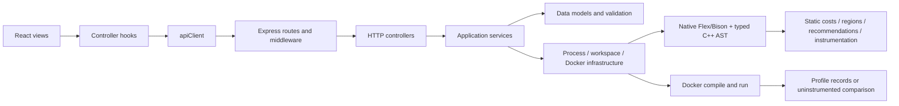

# MVC architecture

OptiScope retains React + Vite + Tailwind + Recharts, Express, a native C++17 analyzer, real Flex/Bison and isolated Docker execution. The five locked SOT-1.0 files remain unchanged. This is an implementation refactor of the existing project.



## Backend responsibilities

| Layer | Actual implementation | Responsibility |
|---|---|---|
| Models | `backend/src/models/AnalysisResult.js`, `SourceUpload.js`, `ProgramRegion.js`, `ProfileRecord.js`, `ComparisonResult.js` | Result envelopes, UTF-8 upload data, region spans, measurement validation and benchmark statistics; no HTTP or subprocess calls |
| Controllers | `backend/src/controllers/AnalysisController.js`, `SampleController.js`, `HealthController.js`, `ComparisonController.js` | Translate validated uploads into service calls and HTTP responses |
| Services | `backend/src/services/AnalysisService.js`, `ProfilingService.js`, `HotspotService.js`, `RecommendationService.js`, `SampleService.js`, `ComparisonService.js` | Analysis/profile/comparison workflows, sample retrieval, ranking, main-time contributions and evidence-based guidance; no Express objects |
| Infrastructure | `backend/src/infrastructure/EngineRunner.js`, `DockerRunner.js`, `ProcessRunner.js`, `JobWorkspace.js` | Native analyzer invocation, fixed Docker arguments, bounded process lifecycle, isolated temporary files and cleanup |
| Transport | `backend/src/routes/*Routes.js`, `middleware/`, `app.js`, `server.js` | Routing, memory uploads, local Host/Origin checks, shared two-job admission, error responses, static hosting and loopback listener |

Analysis and profiling share one controller factory because their upload and response contracts are identical. There is no redundant `ProfilingController` wrapper. Runtime measurements are modeled in `ProfileRecord`, while source geometry is modeled in `ProgramRegion`. Recommendation recognition belongs to the C++ AST subsystem; JavaScript adds only explicitly labeled runtime guidance.

`routes/api.js` composes focused routers. `services/analyzer.js` and `services/process.js` preserve imports used by existing tests/consumers. `server.js` still exports `app`; importing it does not start a listener.

## Frontend responsibilities

- `frontend/src/services/apiClient.js`: the only module calling `fetch`; health, samples, analysis/profile and comparison multipart requests.
- `controllers/useAnalysisController.js`: one source/result/workflow state owner; upload decoding, sample actions, health refresh and region selection. A second upload controller would duplicate this state.
- `controllers/useComparisonController.js`: independent two-file comparison state and actions.
- `models/analysisModel.js`, `sourceModel.js`, `regionModel.js`, `comparisonModel.js`: validate/interpret data without adding invented estimates or timings.
- `views/pages/Dashboard.jsx`, `Comparison.jsx`: composition and display. `views/components/`: upload, actions, metrics, recommendations and console output.
- `components/`: reusable AST, hotspot table, chart and source views. Region/source joins are pure model functions. Components receive data and callbacks, never backend URLs.

`pages/Dashboard.jsx` and `components/regionPresentation.js` are compatibility exports. They retain established entrypoints during the move. No Redux, database or global state framework was introduced.

## Why the compiler is separate

The C++ engine implements parsing, typed AST traversal, symbolic reasoning, source rewriting and serialization. These are compiler responsibilities, not HTTP controllers or React models. `Analysis` owns per-program regions, rules, scopes and cost state. Flex/Bison require the existing parser-root/error globals at their boundary; application analysis state is no longer global. The program currently parses one translation unit per native process.

The backend executes only the trusted native analyzer on the host. Uploaded C++ is compiled and executed exclusively in Docker. Static analysis remains available without Docker; timings remain unavailable in that case.


## C++17 frontend architecture (project-owner authorized upgrade)

The current user task explicitly requests Clang alongside Flex/Bison. The locked SOT files are retained verbatim; this implementation note records that authorization, without rewriting the baseline documents or declaring their version gates complete.

```text
AnalysisController -> AnalysisService -> FrontendRunner.parseInWorkspace
  auto/legacy -> EngineRunner -> native parseLegacy -> Flex/Bison
  clang      -> DockerRunner('clang') -> sandbox.analyze_clang -> parseClang / LibTooling
Both: FrontendResult -> typed Node IR -> Analysis -> region/cost/rule passes -> serialize
Clang rewrite artifact -> bounded host data file -> Docker compile/execute -> profile merge
```

`engine/include/frontend.hpp` defines `FrontendResult`; `parseLegacy` is implemented in `engine/src/legacy_frontend.cpp`, `parseClang` in `engine/clang/frontend.cpp`. Both use `Node`/`Kind` with typed semantic metadata and original byte ranges. Clang preserves opaque unsupported analysis nodes with children. Header declarations and instantiated template copies are not emitted as user source regions. Lambdas are separate source callables; function bodies are deduplicated by original body offset.

LibTooling traverses typed declarations/statements, not an AST dump. `engine/clang/main.cpp` coordinates the shared analysis and decorates serialized results with diagnostics, confidence, instrumentation exclusions, STL operation evidence and recurrence coverage. `stl_costs.cpp` and `recurrences.cpp` are analysis modules, independent of Express and React.

Clang parsing uses the same non-root, network-none, read-only Docker/resource boundary as execution. Static analysis runs only the compiler frontend, never the uploaded program. `/input` contains only the current job and is read-only. Clang has 20 seconds and 8 MiB bounded compiler output; the outer JSON collection is 16 MiB. Runtime profile limits remain 256 MiB, one CPU, 64 PIDs, 20-second compile, five-second run and bounded output. No source-supplied flags, include paths or dependencies are accepted.

macOS development uses the Linux Clang container, avoiding unconfined host header access and Homebrew library ABI coupling. The native academic compiler and React production build are verified on macOS. A direct native macOS LibTooling binary is not verified because its development libraries are absent. Docker installs compatible Clang/LLVM 14 packages; exact image IDs and logs are recorded in validation evidence.

Official implementation references: [Clang LibTooling](https://clang.llvm.org/docs/LibTooling.html) and [RecursiveASTVisitor](https://clang.llvm.org/doxygen/classclang_1_1RecursiveASTVisitor.html). No new frontend dependency was introduced.
